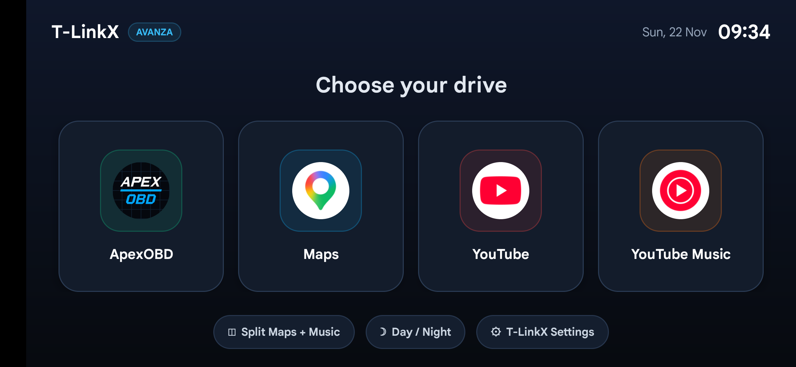
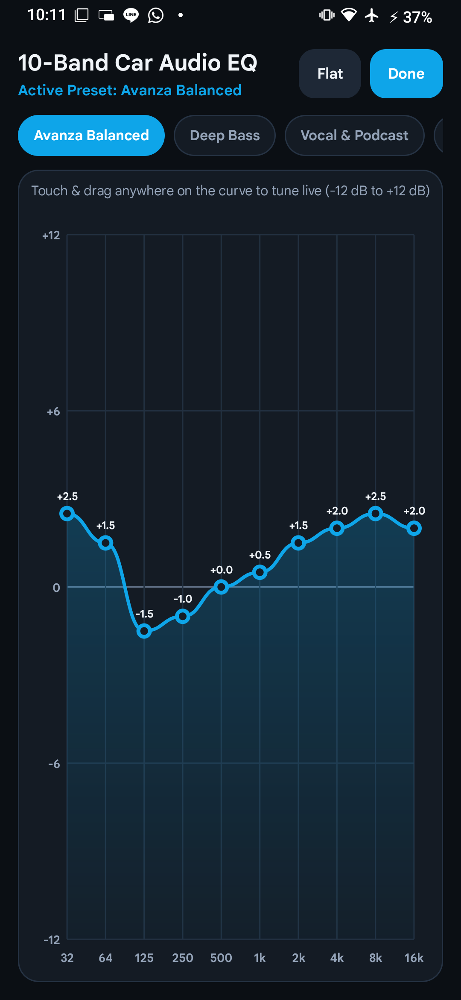
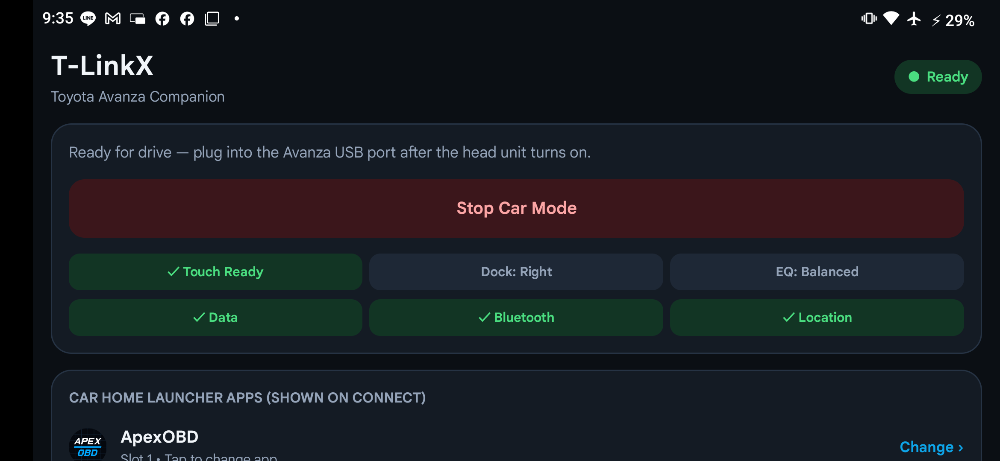

# T-LinkX

### **This is the T-Link you expected all along. Now it's real.**

Plugged your phone into your car's T-Link expecting an Android Auto experience — and got a tiny boxed-in screen with a broken mouse cursor instead?

**T-LinkX** transforms your car's factory T-Link into a sleek, edge-to-edge, touch-ready cockpit the moment you plug in your USB cable.

---

## Why T-LinkX?

| Official T-Link Out of the Box | With **T-LinkX** |
| :--- | :--- |
| Shrunk screen with thick black bars | **True edge-to-edge fullscreen** matched to your car display |
| Broken floating mouse cursor that misses taps | **Real direct touchscreen**, pinch-to-zoom, and Android swipe gestures |
| Drops you onto your cluttered phone screen | **Modern 4-App Car Home** — pick any 4 favorite apps from your phone |
| Phone screen stays hot and lit in your console | **Phone Screen-Off mode** — keep your phone dark while the car screen stays bright, tap phone anywhere to wake |
| Flat factory Bluetooth audio | **10-Band Car Audio EQ** with 8 presets and a live draggable sound curve |
| Manual setup before every drive | **Zero-Touch Auto-Connect** — just plug in and drive, unplug and everything resets |

---

## Visual Preview

### Modern 4-App Car Home
Greets you automatically once connected — no clutter, no side dock until you choose an app. Customize all 4 slots with any app installed on your phone.

### 10-Band Car Audio EQ & Clean Companion App
Tune your car speakers live with a smooth draggable curve, switch presets in one tap, and check that Data, Bluetooth, and Location are ready before you drive.

  
  &nbsp;&nbsp;&nbsp;
  

---

## Key Features

- **Zero-Touch Plug & Drive:** You never need to open T-LinkX before driving. Plug your phone into the car's USB port after the head unit turns on, and T-LinkX handles everything automatically. Unplug, and your phone instantly snaps back to normal.
- **Direct Touchscreen & Multitouch:** Replaces the broken cursor with responsive, accurate finger touch, pinch-to-zoom on Google Maps, and full navigation gestures.
- **Customizable 4-App Car Home:** Pick your 4 go-to driving apps (for example: ApexOBD, Google Maps, YouTube, and YouTube Music) directly from the apps installed on your phone.
- **Floating Car Dock & Resizable Split-Screen:** Appears cleanly on the side once you open an app (positioned for right-hand or left-hand drive). Includes quick access to Car Home, resizable Split-Screen (drag the divider to fit Maps + Music), Play/Pause, Next Track, EQ Tuner, Day/Night theme, and Phone Screen-Off.
- **Phone Screen-Off Mode:** Turns your phone's screen completely dark while mirroring continues smoothly on the dashboard — preventing heat and screen burn-in. Touch anywhere on your phone screen to wake it back up instantly.
- **10-Band Car Audio EQ (Memorized):** Includes 8 car-tuned presets (*Avanza Balanced*, *Deep Bass*, *Vocal & Podcast*, *Rock & Pop*, *Acoustic & Jazz*, *EDM & Hip-Hop*, *Night Drive*) plus a live **Custom** graph that stays saved across drives.
- **Pre-Drive Readiness Check:** Automatically alerts you on your phone if Internet Data, Bluetooth, or Location is turned off, with a one-tap option to enable what's missing or continue anyway.

---

## Requirements & Why Root Is Needed

> **Important:** T-LinkX requires a **rooted Android phone** (KernelSU or Magisk) and the **official T-Link app** installed from the Play Store.

### Why does T-LinkX need Root?
Standard Android security locks normal apps out of fixing the exact things that make factory T-Link frustrating. Root is simply the permission that lets T-LinkX do four things automatically for you:

1. **Fixing the broken touchscreen cursor:** Android normally does not allow regular apps to change how an external car screen's touch input behaves. Root lets T-LinkX replace the broken mouse cursor with real, accurate finger touch.
2. **Filling your car screen edge-to-edge:** Regular apps cannot reshape your phone's screen ratio to match your car's dashboard. Root lets T-LinkX adjust the display cleanly when you plug in and restore it automatically when you unplug.
3. **Turning off your phone screen while driving:** Regular apps can only dim your phone slightly. Root lets T-LinkX turn your phone's display completely off to save battery and prevent heat while your car screen keeps running normally.
4. **Starting automatically with zero taps:** Root lets T-LinkX detect your car's USB cable the moment you plug in — even if the app was closed or stopped by Android's battery saver.

### Why do I still need the official T-Link app?
Your car's head unit only accepts its own authorized video connection from the official T-Link app. Official T-Link quietly handles that video link in the background while **T-LinkX** takes care of the fullscreen display, real touchscreen, Car Home, Split-Screen, Car Dock, Screen-Off mode, and Audio EQ.

---

## Installation Guide

1. **Keep Official T-Link Installed:** Install **T-Link** from the Google Play Store and make sure its permissions (including Accessibility) are enabled once.
2. **Install T-LinkX:** Download and install the latest **T-LinkX** APK on your rooted Android phone.
3. **Grant Root Permission:** Open **KernelSU** (or **Magisk**), go to Superuser, and grant root access to **T-LinkX**.
4. **First-Time Setup:** Open **T-LinkX** once, confirm the top badge shows **Auto-Ready**, customize your **4 Car Home apps**, and pick your favorite **Car Speaker EQ** preset.
5. **Close the App — You're Done:** You never have to open T-LinkX again before driving.

---

## How to Use

1. **Start your car** and wait a few seconds for the head unit home screen to finish loading.
2. **Plug in your USB cable.** T-LinkX automatically resizes the display, enables direct touchscreen, applies your saved Car Audio EQ, and opens the **4-App Car Home** on your dashboard.
3. **Tap any app** to start driving — the slim **Car Dock** appears neatly on the side.
   - Tap **`⌂`** on the dock anytime to return to the 4-App Car Home.
   - Tap **`⊞`** to open **Split-Screen** (drag the center divider to resize).
   - Tap **`EQ`** to tune your 10-Band Car Audio EQ live.
   - Tap **`◐`** to turn off your phone's physical screen while mirroring (touch anywhere on your phone to wake it up).
   - Tap **`›`** to collapse the dock into a tiny edge tab.
4. **Unplug when you arrive.** Your phone screen wakes up (if turned off), snaps back to its normal resolution, restores your volume, and shuts T-LinkX down cleanly until your next drive.

> **Tip for Audio:** T-Link sends video and touch over USB, while audio plays over **Bluetooth**. Switch your car head unit's audio source to **Bluetooth Audio** once so your music and Maps voice play through the car speakers with T-LinkX EQ.

---

*Tested on 2024 Toyota Avanza 1.5G (JVCKENWOOD Display Audio) • Built for drivers who expected more from T-Link.*

